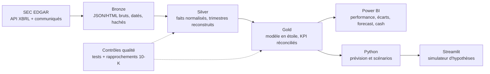
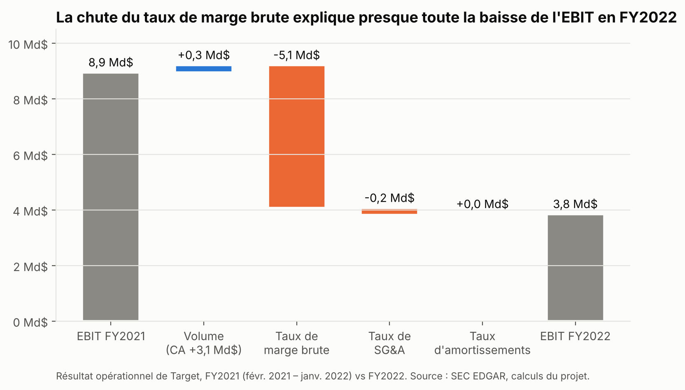

# FP&A Analytics : Target Corporation

> Analyse FP&A de **Target Corporation** (NYSE : TGT) sur ses **comptes réels publiés à la SEC** : pourquoi la marge s'est dégradée, où l'exercice va atterrir, et quels leviers préservent la trésorerie.

[](../../actions/workflows/ci.yml)

## La question métier

En mars 2022, Target annonçait pour l'exercice FY2022 un **taux de marge opérationnelle de 8 % ou plus**. En mai, l'objectif tombait à **environ 6 %**. Au final, le résultat opérationnel est passé de **8,9 Md$ (8,4 % du CA) en FY2021 à 3,8 Md$ (3,5 %) en FY2022**, pour un chiffre d'affaires en hausse à 109,1 Md$.

Ce projet reconstruit l'analyse qu'aurait menée une équipe FP&A :

1. **Pourquoi la marge s'est-elle dégradée ?** Effets volume, panier moyen, mix, démarques et coûts logistiques, avec le lien stocks → marge → cash.
2. **Où l'exercice va-t-il atterrir ?** Rolling forecast trimestriel du CA, de la marge et du cash.
3. **Quels leviers préservent la trésorerie ?** Scénarios sur les stocks, les délais fournisseurs et les investissements.

Les comptes historiques et les objectifs de la direction sont réels et sourcés ; les prévisions et les scénarios sont des calculs propres au projet.

## Stack technique

| Domaine | Technologies |
|---|---|
| Données sources | **XBRL** (comptes balisés des 10-K/10-Q via l'API Company Facts), HTML des communiqués 8-K, API REST SEC EDGAR |
| Ingestion et transformation | **Python** (pandas, requests), architecture médaillon Bronze / Silver / Gold |
| Modélisation | **SQL** (DuckDB), schéma en étoile, Parquet |
| Analyse | pont de résultat opérationnel, effets volume / taux, réel vs guidance, BFR, free cash-flow |
| Restitution | **Power BI** (mesures **DAX**, thème), matplotlib |
| Qualité | pytest, ruff, contrôles de rapprochement avec les 10-K, GitHub Actions (CI) |

## Architecture



| Couche | Contenu | Outils |
|---|---|---|
| **Bronze** | Réponses brutes de la SEC, archivées sans modification, avec journal (URL, date, SHA-256) | Python, requests |
| **Silver** | Une ligne par indicateur et période, libellés harmonisés, trimestres reconstruits à partir des cumuls | pandas, DuckDB, Parquet |
| **Gold** | Faits `financials`, `guidance`, `category_sales` et dimensions `period`, `account` | SQL (DuckDB) |
| **Restitution** | Dashboard 4 pages, simulateur, note de gestion | Power BI, DAX, Streamlit |

## Résultat clé (phase 3)

**La chute du taux de marge brute (−4,7 points) explique −5,1 Md$ sur les −5,1 Md$ de baisse de l'EBIT en FY2022.** Le volume reste positif (+0,3 Md$). La cause : des stocks gonflés de 43 % sur un an, écoulés à coups de démarques, avec un fret plus cher. Le free cash-flow passe de +5,1 Md$ à −1,5 Md$. Détails dans la [note d'analyse](docs/analyse-marge-fy2022.md).



## Avancement

- [x] **Phase 1 : collecte.** Comptes XBRL, liste des dépôts, 31 communiqués de résultats, référentiel de guidance sourcé
- [x] **Phase 2 : fiabilisation.** Couches Silver et Gold, 38 trimestres reconstruits (FY2017 à FY2026-T2), [rapport de contrôles](docs/rapport-controles.md)
- [x] **Phase 3 : analyse et dashboard V1.** Pont de résultat opérationnel, ventes comparables (trafic, panier), réel vs guidance, BFR et free cash-flow, [note d'analyse](docs/analyse-marge-fy2022.md), [guide Power BI](docs/powerbi/README.md)
- [ ] **Phase 4 : prévision et scénarios.** ETS/SARIMA vs référence saisonnière (MAE, WAPE), cash projeté, Streamlit, note de gestion

## Données

| Source | Contenu | Emplacement |
|---|---|---|
| [API Company Facts](https://www.sec.gov/search-filings/edgar-application-programming-interfaces) | 543 concepts XBRL publiés par Target depuis 2008 | `data/bronze/sec/companyfacts/` |
| [API Submissions](https://www.sec.gov/search-filings/edgar-application-programming-interfaces) | Liste des 10-K, 10-Q et 8-K avec liens | `data/bronze/sec/submissions/` |
| Communiqués de résultats (8-K, pièce 99) | Résultats trimestriels et objectifs de la direction | `data/bronze/sec/earnings_releases/` |
| Référentiel de guidance | 58 objectifs chiffrés FY2021–FY2026, chacun cité et lié à sa source | [`data/reference/guidance.csv`](data/reference/guidance.csv) |

Chaque collecte est tracée dans `data/bronze/_ingestion_log.jsonl`. Les instantanés sont versionnés dans le dépôt pour que les analyses soient reproductibles même si la SEC republie des chiffres.

### Points d'attention déjà identifiés

- **Exercice décalé.** L'exercice de Target se termine le samedi le plus proche du 31 janvier : FY2022 couvre février 2022 à janvier 2023. FY2023 compte 53 semaines.
- **Changements de libellés XBRL.** Le chiffre d'affaires passe de `Revenues` (jusqu'en 2015) à `RevenueFromContractWithCustomerExcludingAssessedTax` (à partir de 2017).
- **Changement de présentation au T4 2024.** Le CA devient une seule ligne « Net Sales », et le taux de marge brute est recalculé sur cette base.
- **Montants cumulés.** Les 10-Q publient des cumuls depuis le début de l'exercice. Le T4 se déduit de l'exercice moins les 9 mois.
- **Retraitements.** 115 périodes ont changé de valeur entre deux dépôts ; on garde la dernière version.
- **Balises manquantes.** Le coût des ventes n'est pas balisé de FY2020-T1 à FY2021-T2 ; il est déduit de l'identité du compte de résultat, vérifiée exactement sur les 32 autres trimestres.

## Installation

```bash
git clone https://github.com/norahabrich/fpa-analytics.git
cd fpa-analytics
python -m venv .venv && source .venv/bin/activate
pip install -e ".[dev]"
pytest
```

## Utilisation

La SEC exige un User-Agent avec un contact pour chaque requête :

```bash
export SEC_USER_AGENT="Prénom Nom prenom.nom@exemple.com"

python -m fpa.ingestion.collect                       # comptes + liste des dépôts
python -m fpa.ingestion.earnings_releases             # communiqués de résultats
python -m fpa.ingestion.earnings_releases --offline   # réextraction depuis les archives

python -m fpa.silver.build      # Silver : faits normalisés, trimestres reconstruits
python -m fpa.gold.build        # Gold : modèle en étoile (Parquet + CSV pour Power BI)
python -m fpa.gold.controls     # contrôles qualité -> docs/rapport-controles.md

python -m fpa.analysis.comparable_sales  # ventes comparables extraites des communiqués
python -m fpa.analysis.build             # Gold : ponts EBIT, réel vs guidance
python -m fpa.analysis.charts            # graphiques -> docs/img/
```

### Tables Gold pour Power BI

| Table | Grain | Contenu |
|---|---|---|
| `dim_period` | trimestre fiscal | clé `FY2022-Q1`, dates, nombre de jours et de semaines |
| `dim_account` | compte | libellé, état financier, nature (flux, stock, par action) |
| `fact_financials` | trimestre × compte | valeur en MUSD et méthode d'obtention (publiée ou déduite) |
| `fact_guidance` | objectif publié | fourchette, point central, citation et lien SEC |
| `kpi_quarterly` | trimestre | marges, EBITDA, free cash-flow, DIO, DPO, dette nette, croissance N-1, cumul 12 mois |
| `kpi_annual` | exercice | mêmes indicateurs sur l'exercice, BPA dilué publié |
| `fact_comparable_sales` | trimestre | ventes comparables, trafic, panier moyen (trimestre et cumul) |
| `bridge_operating_income` | période × étape | pont EBIT : volume (trafic, panier, autres), taux de marge brute, SG&A, amortissements |
| `guidance_vs_actual` | objectif publié | objectif, réel comparable, écart et verdict |

Les fichiers sont dans `data/gold/` en CSV (import direct dans Power BI) et en Parquet. Le modèle, les relations, les mesures DAX, le thème et la maquette des pages sont dans [`docs/powerbi/`](docs/powerbi/README.md).

## Structure

```
├── data/
│   ├── bronze/          # données brutes SEC, datées et journalisées
│   ├── silver/          # faits normalisés, trimestres reconstruits
│   ├── gold/            # modèle en étoile et indicateurs pour Power BI
│   └── reference/       # référentiels sourcés : guidance, mapping des comptes, points de rapprochement
├── docs/                # méthodologie, note d'analyse, graphiques, guide Power BI
├── src/fpa/
│   ├── ingestion/       # client SEC, archivage Bronze, inventaires, communiqués
│   ├── silver/          # calendrier fiscal, versions, reconstruction trimestrielle
│   ├── gold/            # SQL DuckDB du modèle en étoile, contrôles qualité
│   └── analysis/        # ventes comparables, ponts EBIT, réel vs guidance, graphiques
└── tests/               # tests unitaires et contrôles de traçabilité
```

## Limites

- Les comptes publiés ne donnent ni le détail par produit ou par magasin, ni les factures. L'analyse se fait au niveau du groupe, des catégories et des indicateurs publiés (transactions, panier moyen).
- La guidance de la direction sert de référence « budget ». Elle n'est pas le budget interne de l'entreprise.
- Projet personnel, sans lien avec Target Corporation.

## Licence

Code sous licence MIT. Les données proviennent de documents publics déposés à la SEC.
