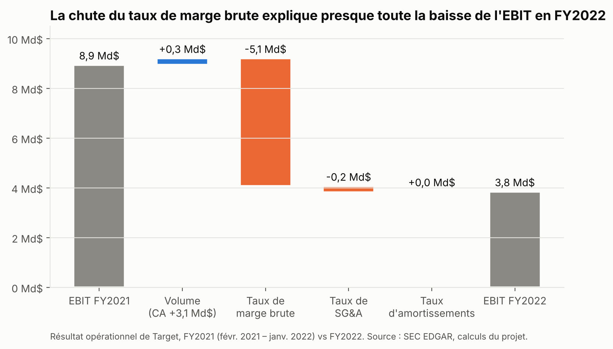
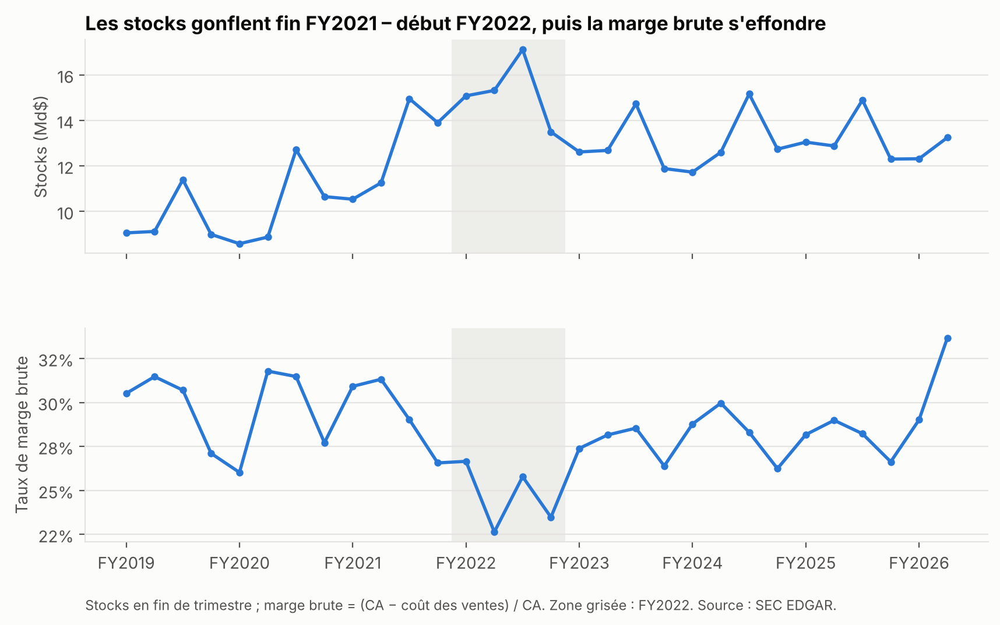
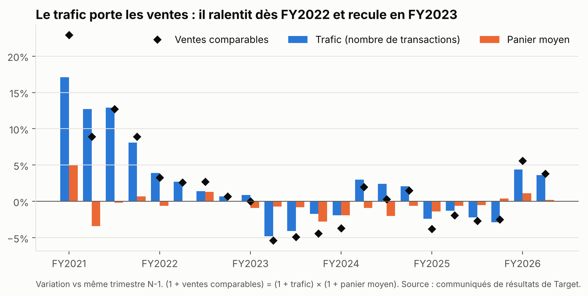
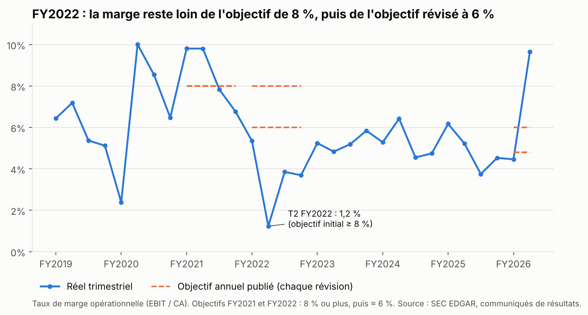

# Analyse : pourquoi la marge de Target s'est effondrée en FY2022

> Note d'analyse de la phase 3. Tous les chiffres viennent des tables Gold (`data/gold/`), elles-mêmes rapprochées des 10-K ([rapport de contrôles](rapport-controles.md)). Montants en millions de dollars (MUSD) sauf mention contraire. FY2022 = février 2022 à janvier 2023.

## En bref

1. **Le résultat opérationnel (EBIT) passe de 8,9 Md$ à 3,8 Md$ (−5,1 Md$)** alors que le chiffre d'affaires progresse de 2,9 %. Le volume n'est pas en cause : il apporte +0,3 Md$.
2. **La baisse du taux de marge brute (−4,7 points) explique à elle seule −5,1 Md$**, soit la quasi-totalité de l'écart. Les frais commerciaux et administratifs (SG&A) pèsent −0,2 Md$.
3. **La cause est un excès de stocks** : +43 % sur un an à la fin du T1, écoulé à coups de démarques (*markdowns*), sur fond de hausse du fret et des coûts logistiques.
4. **Le cash en paie le prix** : le free cash-flow passe de +5,1 Md$ à −1,5 Md$, et la dette nette double presque (7,8 → 13,9 Md$).
5. **La direction a raté son objectif deux fois** : 8 % ou plus annoncé en mars, environ 6 % en mai, **3,5 % réalisé**.

## 1. Le pont de résultat opérationnel

| Étape | Effet sur l'EBIT | Lecture |
|---|---:|---|
| EBIT FY2021 | 8 946 | 8,4 % du CA |
| Volume : trafic | +188 | +2,1 % de transactions (ventes comparables) |
| Volume : panier moyen | +9 | panier quasi stable (+0,1 %) |
| Volume : magasins, autres revenus | +66 | nouveaux magasins, revenus hors marchandises |
| **Taux de marge brute** | **−5 140** | **29,3 % → 24,6 % du CA** |
| Taux de SG&A | −249 | +0,2 point de CA |
| Taux d'amortissements | +28 | stable |
| EBIT FY2022 | 3 848 | 3,5 % du CA |

**Méthode** (détaillée dans [`variance.py`](../src/fpa/analysis/variance.py)). Avec R le CA et g, s, d les taux de marge brute, de SG&A et d'amortissements :

- effet volume = ΔR × marge opérationnelle N-1 (le CA supplémentaire, rapporté à la marge de l'an dernier) ;
- effet de chaque taux = R(N) × variation du taux.

Les effets s'additionnent **exactement** à l'écart d'EBIT, sans résidu. L'effet volume se découpe ensuite en trafic et panier moyen grâce aux ventes comparables publiées : (1 + ventes comparables) = (1 + trafic) × (1 + panier moyen).

**Trimestre par trimestre**, l'effet du taux de marge brute est de −1,1 Md$ au T1 (−4,3 points) puis **−2,3 Md$ au T2 (−8,7 points)**, le trimestre où Target a liquidé ses stocks excédentaires. L'EBIT du T2 tombe à 321 MUSD, contre 2 467 un an plus tôt.

## 2. Pourquoi la marge brute ? Les stocks

| Fin de trimestre | Stocks | DIO (jours) | Taux de marge brute | Flux de trésorerie opérationnel |
|---|---:|---:|---:|---:|
| FY2021-Q1 | 10 539 | 57 | 30,9 % | 1 139 |
| FY2021-Q3 | 14 958 | 75 | 29,0 % | 2 175 |
| FY2022-Q1 | 15 083 | 74 | 26,7 % | **−1 394** |
| FY2022-Q2 | 15 320 | 69 | **22,6 %** | 1 347 |
| FY2022-Q3 | 17 117 | 79 | 25,8 % | 599 |
| FY2022-Q4 | 13 499 | 51 | 23,5 % | 3 466 |

DIO (*days inventory outstanding*) = stocks / coût des ventes × nombre de jours : le nombre de jours de ventes immobilisés en stock.

Target a commandé pour une demande « post-Covid » qui ne s'est pas matérialisée dans les catégories discrétionnaires (maison, électronique, loisirs). Les communiqués de résultats le disent explicitement :

- **T1 FY2022** (18 mai 2022) : la marge brute « reflected higher markdown rates, driven largely by inventory impairments and actions taken to address lower-than-expected sales in discretionary categories, as well as costs related to freight, supply chain disruptions, and increased compensation and headcount in our distribution centers » ([source](https://www.sec.gov/Archives/edgar/data/27419/000002741922000011/a2022q1ex-99.htm)).
- **T2 FY2022** (17 août 2022) : « Operating margin rate of 1.2 percent reflected gross margin pressure from actions to reduce excess inventory as well as higher freight and transportation costs. » Et : « Fall season receipts in discretionary categories were reduced by more than $1.5 billion » ([source](https://www.sec.gov/Archives/edgar/data/27419/000002741922000023/a2022q2ex-99.htm)).
- **Exercice FY2022** (28 février 2023) : « Full-year gross margin rate was 23.6 percent, compared with 28.3 percent in 2021, reflecting pressure from higher clearance and promotional markdown rates, higher net merchandise and freight costs, higher supply chain costs reflecting increased compensation and headcount in the Company's distribution centers, and higher inventory shrink » ([source](https://www.sec.gov/Archives/edgar/data/27419/000002741923000010/a2022q4ex-99.htm)).

Les quatre moteurs de la baisse sont donc : **démarques et soldes**, **coût des marchandises et du fret**, **coûts logistiques** (salaires en entrepôt) et **démarque inconnue** (*shrink* : vols et pertes). Les comptes publiés ne donnent pas leur poids respectif : le pont s'arrête au taux de marge brute global.

Le taux de 23,6 % cité par Target porte sur les seules ventes de marchandises ; le nôtre (24,6 %) porte sur le CA total, autres revenus compris. L'écart de marge entre les deux exercices est du même ordre (−4,7 points).

## 3. Les ventes tiennent, mais le trafic s'essouffle

| Exercice | Ventes comparables | Trafic | Panier moyen |
|---|---:|---:|---:|
| FY2021 | +12,7 % | +12,3 % | +0,4 % |
| FY2022 | +2,2 % | +2,1 % | +0,1 % |
| FY2023 | −3,7 % | −2,4 % | −1,4 % |

En FY2022 la croissance vient encore du trafic, mais elle ralentit chaque trimestre (+3,9 % au T1, +0,7 % au T4). En FY2023 le trafic recule et le CA baisse de 1,6 % : la marge brute se redresse (27,5 %) grâce à des stocks assainis, mais le levier volume disparaît.

## 4. Réel contre objectifs de la direction

| Date | Objectif publié pour FY2022 | Réel | Verdict |
|---|---|---:|---|
| 1er mars 2022 | marge opérationnelle de 8 % ou plus | 3,5 % | sous l'objectif |
| 1er mars 2022 | croissance du CA « low- to mid-single digit » (1 à 6 %) | 2,9 % | dans la fourchette |
| 18 mai 2022 | marge du T2 autour de 5,3 % | 1,2 % | sous l'objectif |
| 18 mai 2022 | marge annuelle autour de 6 % | 3,5 % | sous l'objectif |
| 17 août 2022 | marge du 2e semestre autour de 6 % | 3,8 % | sous l'objectif |
| 16 nov. 2022 | marge du T4 autour de 3 % | 3,7 % | au-dessus de l'objectif |
| 16 nov. 2022 | ventes comparables du T4 en légère baisse (−3 à −1 %) | +0,7 % | au-dessus de l'objectif |

Le CA a toujours été dans la cible : **c'est la marge que la direction n'a pas su prévoir**. Il a fallu attendre novembre, avec des stocks déjà assainis, pour que la prévision redevienne fiable. Toutes les lignes, avec citation et lien, sont dans [`guidance_vs_actual.csv`](../data/gold/guidance_vs_actual.csv).

## 5. Le cash : BFR et investissements

| | FY2021 | FY2022 | FY2023 |
|---|---:|---:|---:|
| Flux de trésorerie opérationnel | 8 625 | 4 018 | 8 621 |
| Investissements (capex) | 3 544 | 5 528 | 4 806 |
| **Free cash-flow** | **5 081** | **−1 510** | **3 815** |
| Dette nette en fin d'exercice | 7 809 | 13 910 | 12 233 |

Deux effets se cumulent en FY2022 :

- **le BFR** (besoin en fonds de roulement) : au T1, les stocks montent pendant que les dettes fournisseurs baissent (14 053 contre 15 478 trois mois plus tôt). Le flux opérationnel du trimestre est négatif (−1,4 Md$) ;
- **les investissements** restent au plus haut (5,5 Md$ : magasins, centres de tri) alors que le résultat s'effondre.

Le free cash-flow négatif est financé par la dette : la dette nette passe de 7,8 à 13,9 Md$. En fin d'exercice, la réduction des stocks (13,5 Md$, DIO 51 jours) libère du cash au T4.

## 6. Ce qu'un FP&A aurait surveillé

- **Stocks vs ventes** : à la fin du T1 FY2022, les stocks progressent de 43 % sur un an quand le CA du trimestre progresse de 4 %. Un DIO à 74 jours contre 57 un an plus tôt est un signal avancé de démarques à venir, visible avant le choc du T2.
- **Mix discrétionnaire** : les ventes comparables tiennent, mais le trafic ralentit chaque trimestre.
- **Sensibilité de l'objectif** : sur 109 Md$ de CA, 1 point de marge brute vaut environ 1,1 Md$ d'EBIT. Un objectif à 8 % supposait de garder le taux de marge brute de FY2021.

La phase 4 transformera ces signaux en prévision trimestrielle (référence saisonnière, ETS, SARIMA) et en scénarios de cash.

## Limites

- **Ventes comparables** : elles ne portent que sur les ventes de marchandises des magasins ouverts depuis plus d'un an et du digital. Le découpage trafic / panier de l'effet volume est donc une approximation ; le reste va dans « magasins, autres revenus ».
- **BPA** : la guidance porte sur un BPA ajusté, comparé ici au BPA GAAP dilué (seul balisé en XBRL).
- **Changement de définition au T4 2024** : Target publie désormais un seul « Net Sales » et recalcule son taux de marge brute. Nos taux restent calculés sur le CA total, de façon homogène sur toute la période.
- **Exercices de 53 semaines** (FY2017, FY2023) : la croissance annuelle du CA inclut la semaine supplémentaire.
- **Granularité** : les comptes publiés ne détaillent ni les démarques, ni le fret, ni le *shrink*. Le pont s'arrête au taux de marge brute global ; les causes viennent des commentaires de la direction.
