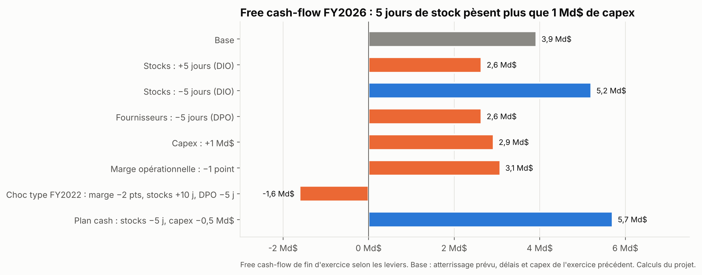

# Note de gestion : Target, atterrissage FY2026 et trésorerie

*À l'attention de la direction financière. Situation à fin T2 FY2026 (1er août 2026). Données publiques SEC EDGAR, prévisions et scénarios calculés par le projet.*

## Message clé

**L'exercice FY2026 devrait atterrir légèrement sous la guidance, mais à l'intérieur de nos intervalles de prévision.** Le risque principal n'est pas le chiffre d'affaires mais la marge, et la trésorerie dépend avant tout de la discipline sur les stocks.

| | Prévision du projet | Intervalle à 80 % | Guidance du 19 août 2026 |
|---|---:|---:|---:|
| Croissance du CA | **+4,4 %** (109,4 Md$) | +1,9 % à +6,0 % | environ +5 % |
| Taux de marge opérationnelle | **5,6 %** (6,1 Md$) | 3,6 % à 7,0 % | environ 6 % |
| Free cash-flow | **3,9 Md$** | scénarios ci-dessous | non publié |
| Dette nette fin d'exercice | **9,5 Md$** | | |

## Ce que disent les chiffres

1. **Le premier semestre est solide, mais flatté par un élément ponctuel.** La marge du T2 atteint 9,6 %, portée par des remboursements de droits de douane (environ 90 points de base sur l'année selon la direction). Sans cet effet, notre prévision du 2e semestre repart des niveaux de FY2025 : 3,8 % au T3 et 4,5 % au T4.
2. **Le CA est prévisible, la marge beaucoup moins.** En validation chronologique, notre meilleur modèle se trompe de 2,9 % en moyenne sur le CA trimestriel, contre 1,5 point sur le taux de marge, soit près de 30 % de la marge elle-même. FY2022 l'a montré : un CA dans la cible et une marge à 3,5 % contre 8 % annoncés.
3. **Chaque jour de stock vaut environ 256 MUSD de trésorerie** en fin d'exercice. Cinq jours de stock (1,3 Md$) pèsent plus qu'un milliard de capex supplémentaire.

## Scénarios de free cash-flow FY2026

| Scénario | Free cash-flow | Écart vs base | Dette nette fin |
|---|---:|---:|---:|
| Base | 3,9 Md$ | | 9,5 Md$ |
| Stocks +5 jours | 2,6 Md$ | −1,3 Md$ | 10,8 Md$ |
| Délais fournisseurs −5 jours | 2,6 Md$ | −1,3 Md$ | 10,8 Md$ |
| Capex +1 Md$ | 2,9 Md$ | −1,0 Md$ | 10,5 Md$ |
| Marge opérationnelle −1 point | 3,1 Md$ | −0,8 Md$ | 10,4 Md$ |
| **Choc type FY2022** (marge −2 pts, stocks +10 j, fournisseurs −5 j) | **−1,6 Md$** | −5,5 Md$ | 15,0 Md$ |
| **Plan cash** (stocks −5 j, capex −0,5 Md$) | **5,7 Md$** | +1,8 Md$ | 7,7 Md$ |

## Recommandations

1. **Piloter les stocks à l'entrée de la saison de fin d'année** : fixer un plafond de DIO à fin T3 (74 jours en FY2025) et réduire les réceptions discrétionnaires dès que les ventes comparables décrochent, comme en août 2022.
2. **Présenter la marge hors éléments ponctuels** : communiquer et suivre un taux hors remboursements de droits de douane pour éviter une base de comparaison flatteuse en FY2027.
3. **Suivre trois indicateurs avancés chaque mois** : trafic (ventes comparables), DIO, taux de démarque. Ce sont les signaux qui ont précédé la chute de 2022.
4. **Arbitrer le capex en dernier** : à impact égal sur le cash, réduire de 4 jours les stocks est moins coûteux pour la croissance que de couper 1 Md$ d'investissements.

*Méthodes, limites et code : [`docs/phase-4-prevision.md`](phase-4-prevision.md), simulateur `streamlit run app/simulateur.py`.*
