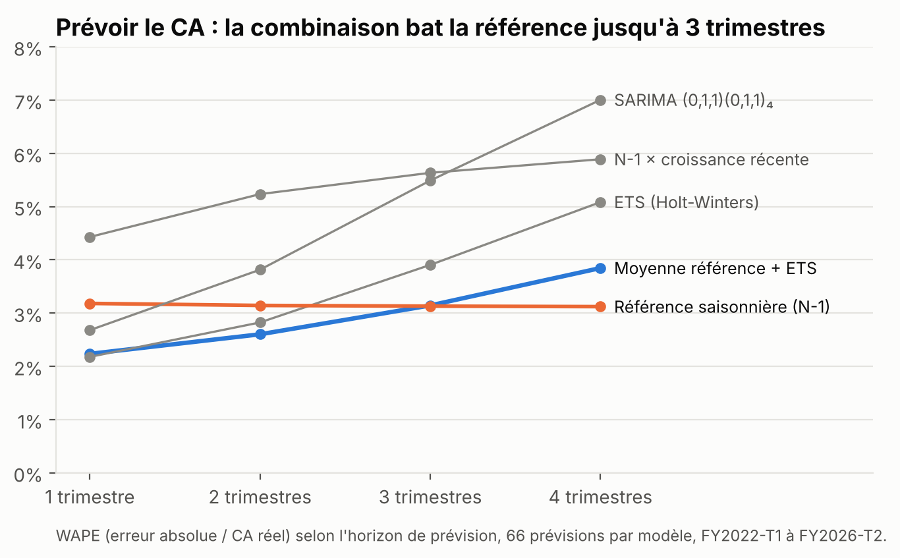
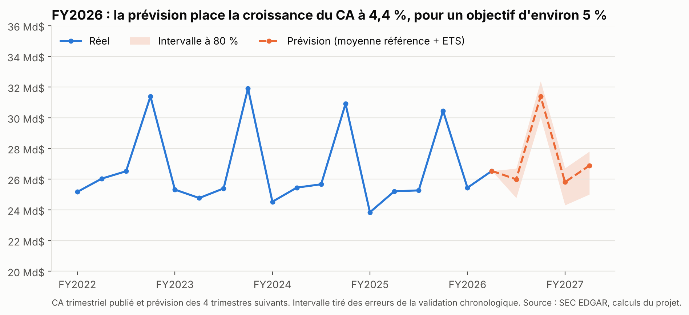
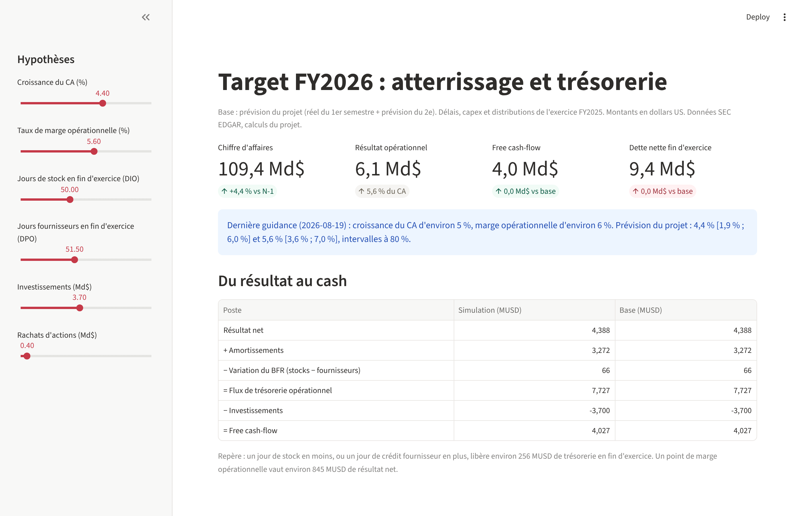

# Phase 4 : prévision, atterrissage et scénarios de cash

Cette phase répond à la deuxième et à la troisième question du projet : **où l'exercice va-t-il atterrir, et quels leviers préservent la trésorerie ?** La synthèse pour la direction est dans la [note de gestion](note-de-gestion.md).

```
kpi_quarterly (Gold)
   │
   ├─► validation chronologique ──► forecast_scores, forecast_backtest
   │      5 modèles × 66 prévisions
   │
   ├─► prévision 4 trimestres ────► forecast_quarterly (avec intervalle à 80 %)
   │
   ├─► atterrissage FY2026 ───────► forecast_landing (vs dernière guidance)
   │
   └─► modèle de cash ────────────► cash_scenarios, cash_proxy_check
                                        │
                                        └─► simulateur Streamlit
```

## 1. Les modèles comparés

| Modèle | Idée | Code |
|---|---|---|
| Référence saisonnière | même trimestre de l'an dernier | `naive_seasonal` |
| N-1 × croissance récente | référence × croissance des 4 derniers trimestres | `naive_seasonal_growth` |
| ETS (Holt-Winters) | lissage exponentiel, tendance amortie, saisonnalité multiplicative | `ets` |
| SARIMA (0,1,1)(0,1,1)₄ | modèle « airline » sur le logarithme | `sarima` |
| Combinaison | moyenne de la référence et de l'ETS | `combo` |

La **référence saisonnière** est le modèle à battre : un modèle plus complexe n'a d'intérêt que s'il fait mieux qu'elle.

Le CA est d'abord ramené à **13 semaines** : les T4 des exercices de 53 semaines (FY2017, FY2023) en comptent 14 et gonfleraient artificiellement la saisonnalité.

## 2. La validation chronologique

On ne mélange jamais passé et futur. À chaque trimestre d'origine, de FY2021-T4 à FY2026-T1, chaque modèle est entraîné **sur le passé seulement**, puis prévoit les 1 à 4 trimestres suivants. On obtient 66 prévisions par modèle, comparées au réel :

- **MAE** (*mean absolute error*) : erreur moyenne en MUSD ;
- **WAPE** (*weighted absolute percentage error*) : Σ |erreur| / Σ réel, comparable entre séries ;
- **biais** : Σ (prévision − réel) / Σ réel, positif quand on surestime.

### Chiffre d'affaires

| Modèle | MAE (MUSD) | WAPE | Biais |
|---|---:|---:|---:|
| **Combinaison référence + ETS** | **780** | **2,9 %** | +1,1 % |
| Référence saisonnière | 841 | 3,1 % | 0,0 % |
| ETS | 916 | 3,4 % | +2,3 % |
| SARIMA | 1 241 | 4,6 % | +2,4 % |
| N-1 × croissance récente | 1 407 | 5,3 % | +1,7 % |



La combinaison gagne jusqu'à 3 trimestres d'horizon ; au-delà, la référence saisonnière reste aussi bonne. L'ETS et le SARIMA surestiment : ils ont appris la forte croissance de 2020–2021, qui ne s'est pas prolongée. Extrapoler la croissance récente est la pire stratégie.

### Taux de marge opérationnelle

| Modèle | MAE (points) | WAPE |
|---|---:|---:|
| ETS | 1,5 | 29 % |
| Combinaison | 1,6 | 30 % |
| SARIMA | 1,8 | 36 % |
| Référence saisonnière | 1,9 | 37 % |

La marge est **dix fois plus difficile à prévoir** que le CA : une erreur de 1,5 point représente près de 30 % de la marge elle-même. C'est la leçon de FY2022.

## 3. Atterrissage FY2026

Réel du T1 et du T2, prévision du T3 et du T4 :

- **CA** : combinaison référence + ETS (meilleur WAPE). Intervalle à 80 % tiré des quantiles de l'erreur relative en validation chronologique, par horizon.
- **Marge** : référence saisonnière. L'ETS ferait mieux en moyenne, mais il propagerait au 2e semestre le pic ponctuel du T2 FY2026 (9,6 %, remboursements de droits de douane). Intervalle tiré des erreurs en points de la validation.

| | Atterrissage | Intervalle à 80 % | Guidance (19/08/2026) | Écart |
|---|---:|---:|---:|---:|
| Croissance du CA | +4,4 % | +1,9 % à +6,0 % | ≈ +5 % | −0,6 pt |
| Taux de marge opérationnelle | 5,6 % | 3,6 % à 7,0 % | ≈ 6 % | −0,4 pt |



## 4. Modèle de cash

```
Résultat net      = (EBIT − intérêts) × (1 − taux d'impôt)
Flux opérationnel ≈ résultat net + amortissements − Δ stocks + Δ dettes fournisseurs
Free cash-flow    = flux opérationnel − capex
Dette nette fin   = dette nette début − (free cash-flow − dividendes − rachats d'actions)
Stocks fin        = DIO × coût des ventes du T4 / 91 jours   (idem dettes fournisseurs avec le DPO)
```

**Contrôle sur le passé** (`cash_proxy_check`) : l'écart entre ce flux simplifié et le flux publié reste sous 0,75 % du CA, sauf en FY2020 (2,6 %, effets Covid sur les autres éléments du BFR) et FY2023 (1,4 %).

**Hypothèses de base** : CA et marge de l'atterrissage ; taux d'impôt, amortissements, intérêts, capex, dividendes et rachats de FY2025 ; DIO et DPO de fin FY2025 (50 et 51 jours).

## 5. Simulateur

```bash
pip install -e ".[app]"
streamlit run app/simulateur.py
```

Six curseurs (croissance, marge, DIO, DPO, capex, rachats d'actions) et un pont « du résultat au cash ». Toute la logique vient de `fpa.forecast.cash`, testée ; l'application ne fait que l'afficher.



## Limites

- **38 trimestres seulement**, dont la période Covid : les modèles ont peu d'histoire stable. Les intervalles sont empiriques (erreurs passées), pas des intervalles de confiance théoriques.
- **Élément ponctuel du T2 FY2026** : la référence saisonnière le reprend pour la prévision de FY2027-T2 (9,6 %). Cette prévision n'est pas utilisée dans l'atterrissage.
- **Guidance « ajustée »** : la marge visée par Target est un taux ajusté ; le nôtre est le taux GAAP publié.
- **Modèle de cash simplifié** : il ignore les autres postes du BFR, les impôts différés et les rémunérations en actions. D'où l'écart de 2,6 % du CA en FY2020.
- **Pas de prévision de l'économie** : aucun facteur externe (consommation, taux, droits de douane) n'entre dans les modèles.
